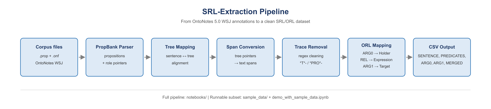

# SRL-Extractor

[](https://doi.org/10.5281/zenodo.20749117)
[](https://www.gnu.org/licenses/gpl-3.0)
[](https://colab.research.google.com/github/Amirmohammadomidi/srl-data-extraction/blob/master/demo_with_sample_data.ipynb)

**SRL-Extractor** builds a high-quality Semantic Role Labeling (SRL) dataset from the Wall Street Journal (WSJ) section of the OntoNotes 5.0 corpus. It aligns PropBank predicate-argument annotations with Penn Treebank syntax, converts tree pointers into surface spans, removes trace anchors, and exports a clean CSV for downstream SRL and Opinion Role Labeling (ORL) research.

The final OntoNotes-filtered dataset contains **97,169 predicate-argument instances** with ARG0 (Agent), REL (Predicate), and ARG1 (Patient) annotations. These roles map naturally to ORL's **Holder**, **Expression**, and **Target** schema.

## Architecture



The pipeline has seven stages:

1. **Corpus files** — read PropBank `.prop` annotations and OntoNotes `.onf` sentences and trees.
2. **PropBank parser** — extract propositions and their role pointers.
3. **Tree mapping** — align each proposition with its sentence and parse tree.
4. **Span conversion** — resolve `PropbankTreePointer`s to surface text spans.
5. **Trace removal** — strip `*T*-`, `*PRO*-`, `*?*`, `*-N`, and `*` anchors with a regex.
6. **ORL mapping** — map ARG0 → Holder, REL → Expression, ARG1 → Target.
7. **CSV export** — write the final dataset.

The sample demo runs the same stages on a small subset; the full notebooks contain the corpus-specific alignment fixes.

## Project structure

```text
srl-data-extraction/
├── assets/                      # Pipeline flowchart
├── notebooks/                   # Full extraction notebooks (with outputs)
├── notebooks-no-output/         # Clean copies of the full notebooks
├── sample_data/                 # Small testing subset + expected output
├── CITATION.cff
├── demo_with_sample_data.ipynb  # Runnable demo
├── README.md
└── requirements.txt
```

## Installation

```bash
git clone https://github.com/Amirmohammadomidi/srl-data-extraction.git
cd srl-data-extraction
python -m venv .venv
source .venv/bin/activate   # Windows: .venv\Scripts\activate
pip install --upgrade pip
pip install -r requirements.txt
```

**Requirements:** `nltk>=3.8.0`, `pandas>=1.5.0`, `numpy>=1.21.0`, `jupyter>=1.0.0`.

## Quick start (no OntoNotes download)

The `sample_data/` folder contains eight matching `.prop`/`.onf` pairs from the WSJ section and the expected output. Run the demo notebook:

```bash
jupyter notebook demo_with_sample_data.ipynb
```

or click the **Open in Colab** badge above. The notebook:

- reads `sample_data/`;
- runs the extraction pipeline end to end;
- writes `outputs/sample_output.csv`;
- checks that the result matches `sample_data/expected_output.csv` (107 rows).

No LDC license or OntoNotes download is needed for the demo. On Colab, the notebook fetches only `sample_data/` with a sparse Git checkout.

## Output format

The full notebooks (`df.csv` and `dataset.csv`) and the sample demo (`outputs/sample_output.csv`) use the same five columns:

| Column | Description | ORL equivalent |
|---|---|---|
| `SENTENCE` | Trace-cleaned, tokenized Treebanked sentence | — |
| `PREDICATES` | Surface span of the predicate (REL) | Expression |
| `ARG0` | Surface span of the Agent/Proto-Agent argument | Holder |
| `ARG1` | Surface span of the Patient/Proto-Patient argument | Target |
| `Merged_Arguments` | `ARG0` and `ARG1` joined by a pipe character | — |

Empty roles are stored as empty strings. Rows where both ARG0 and ARG1 are empty are removed. Example:

```csv
SENTENCE,PREDICATES,ARG0,ARG1,Merged_Arguments
"W.R. Grace holds three of Grace Energy 's seven board seats .",holds,W.R. Grace,three of Grace Energy 's seven board seats,W.R. Grace|three of Grace Energy 's seven board seats
```

## Full pipeline (OntoNotes 5.0)

The full extraction requires the [OntoNotes 5.0 corpus](https://catalog.ldc.upenn.edu/LDC2013T19) (LDC2013T19) and the [PropBank release](https://github.com/propbank/propbank-release). The notebooks are designed to run on Google Colab:

1. Open `notebooks/[1st_NoteBook]_SRL_DATA_EXTRACTION.ipynb` and run all cells. It clones the PropBank release, reads the WSJ `.prop` and `.onf` files, and writes `df.csv`.
2. Open `notebooks/[2nd_NoteBook]_SRL_DATA_EXTRACTION.ipynb`, point it at `df.csv`, and run all cells. It keeps only the observations that also exist in OntoNotes and writes `dataset.csv`.

Both notebooks contain placeholders for the dataset download URLs. Replace them with your own Google Drive or direct download links, or point the file paths at a local OntoNotes checkout. See `notebooks-no-output/` for clean copies without saved outputs.

## Citation

If you use this software or dataset, please cite:

```bibtex
@article{omidi_galdiani2025srl,
  title   = {From Semantic Roles to Opinion Roles: SRL Data Extraction for Multi-Task and Transfer Learning in Low-Resource ORL},
  author  = {Omidi Galdiani, Amirmohammad and Rezaei Melal, Sepehr and Norasteh, Mohammad and Yousefi Jordehi, Arash and Mirroshandel, Seyed Abolghasem},
  journal = {arXiv preprint arXiv:2511.08537},
  year    = {2025},
  doi     = {10.48550/arXiv.2511.08537},
  url     = {https://arxiv.org/abs/2511.08537}
}
```

The archived software release is available on Zenodo (see the DOI badge). GitHub also exposes `CITATION.cff` through **Cite this repository**.

## Data and license

- The **code** in this repository is licensed under the [GNU General Public License v3.0](LICENSE).
- The **OntoNotes 5.0** files and the sample subset are subject to the [LDC license](https://catalog.ldc.upenn.edu/LDC2013T19). They are included only for testing and reproducibility. Obtain the full corpus from LDC for research use.
- The `.prop` files originate from the [PropBank release](https://github.com/propbank/propbank-release) and retain their original license.

## Acknowledgements

OntoNotes 5.0 (LDC2013T19), PropBank, and the Penn Treebank.
